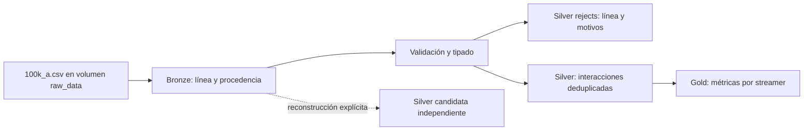

# Arquitectura I1

Los siguientes son **destinos previstos por el código**, no inventario de objetos
existentes. Namespace inicial: `workspace.twitch_lakehouse`.

| Objeto | Granularidad / propósito |
| --- | --- |
| Volumen `raw_data` | Archivo original cargado manualmente |
| `bronze_interactions` | Una fila por línea: `raw_line`, `source_file`, `ingested_at` |
| `silver_interactions` | Tupla única de cinco campos normalizados + `estimated_minutes` |
| `silver_rejects` | Original, procedencia, campos parseados y `quality_errors` |
| `gold_streamer_metrics` | Un streamer: interacciones, usuarios/streams distintos, minutos estimados |
| `silver_interactions_candidate_<sufijo>` | Reconstrucción aislada explícita |
| `silver_rejects_candidate_<sufijo>` | Rechazos de esa reconstrucción |

Tablas Delta administradas; sin particiones anticipadas, Auto Loader, streaming ni
infraestructura adicional. DataFrames/SQL compatibles con Spark Connect; sin RDD,
SparkContext, UDF, cache ni configuración de clúster.

Bronze conserva texto sin inferir tipos. Silver excluye rechazos y elimina duplicados
por la tupla completa; Gold resume Silver. Procedencia en Bronze y cuarentena, sin
elegir una procedencia arbitraria al deduplicar Silver.
Mantener el volumen sin cambios durante la ejecución; no hay ingesta concurrente.

Las escrituras son individuales, sin transacción multicapa. Si falla una después de
crear otra, detener y revisar: no hay borrado ni reparación automática. Para repetir
de extremo a extremo usar otro esquema aislado y volver a cargar la fuente.
Reejecutar al mismo destino se bloquea; no es un upsert incremental.
Kafka queda fuera del flujo batch I1 implementado.
