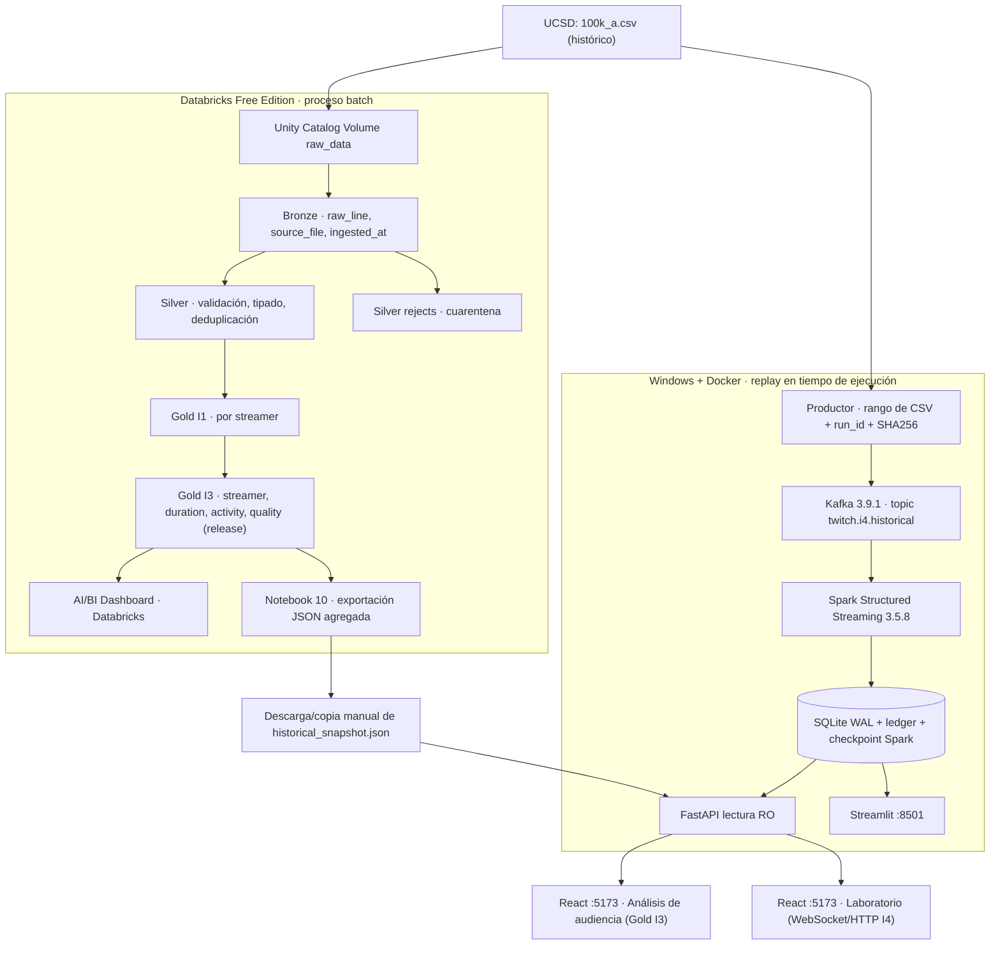
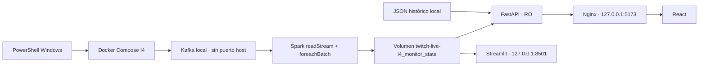

# 02. Arquitectura y flujos de datos

## Vista general — **dos rutas independientes**

**No hay flecha directa Kafka→Databricks ni sincronización automática Gold→React.** La única transferencia de Gold a React es exportación descargada manualmente, montada RO y leída por FastAPI. Son dos universos de métricas que **nunca deben sumarse**.

## Vista de ejecución local

## Tabla de decisiones y garantías

| Decisión | Motivo | Qué puede comprobarse |
| --- | --- | --- |
| Delta Bronze/Silver/Gold, versiones de origen | Trazabilidad y validación por capas | `DESCRIBE DETAIL/HISTORY`, SQL de conciliación |
| Gold I3 separado y versionado con quality final | No sobrescribir I1; leer solo releases completas | Cuatro tablas por sufijo y quality único PASS |
| CSV replay con `event_id` determinista por `run_id`, SHA256, fila | Idempotencia ante reenvío del mismo rango | Kafka offsets pueden crecer, `events` no |
| Spark `foreachBatch` + SQLite WAL | Persistir lotes, ledger y agregados con transacciones | SQLite y API concilian, reinicio controlado |
| WebSocket cada ~2 s y fallback HTTP | Actualización reactiva con alternativa | Navegador: 0→parcial→N, aviso WS/polling |
| FastAPI RO y Nginx same-origin | No exponer escritura ni tokens Databricks | Compose `:ro`, endpoint `health`, rutas |
| JSON I3 estático con fecha/release | Desacoplar Databricks Free de contenedor | `historical_snapshot.json` y `GET /historical` |

## Distinguir tiempos y población

- `time_start/time_stop`: pasos relativos de diez minutos en el archivo histórico; no son fecha de transmisión.
- `produced_at`, `completed_at`: horas reales del *replay* y sus micro-lotes; **no** antigüedad de la interacción histórica.
- `exported_at`: momento UTC en que se congelaron agregados Gold; tampoco fecha de transmisión.
- `status=RUNNING`: indica último estado del consumidor, no garantiza salud de Kafka ni su disponibilidad sin inspección adicional.
- `transport_total`, último lote, heartbeat y offsets son **globales**; el filtro `run_id` aplica a eventos, KPIs, streamers y actividad de esa ejecución.
- 100, 1.000 y 3.051.733 son poblaciones distintas en pruebas/contextos distintos; no se infiere throughput, latencia o concurrencia entre ellas.

## Modelo de riesgo

- Si los componentes Kafka, checkpoint y SQLite se desincronizan por borrar uno, la garantía de no duplicar no está demostrada. No reinicializar por conveniencia.
- Si el notebook I3 falla en mitad de crear familias, **quality no garantiza un commit atómico multitabla**. No consumir una release sin una fila quality PASS y conciliación completa.
- API SQLite RO puede devolver 503 en arranque frío antes de que Spark escriba archivos WAL auxiliares; no montar el volumen RW para «arreglar».
- No hay seguridad ni alta disponibilidad exigible para exposición pública: mantener en loopback y sin secretos.

Para detalle de componentes: `docs/arquitectura.md`, `live_monitor/ARCHITECTURE.md` y `audience_experience/docs/ARCHITECTURE.md`. 
