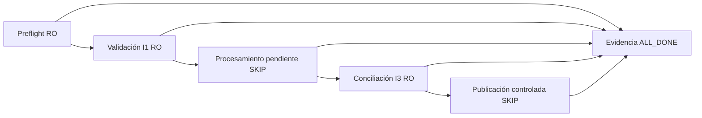

# Job v1 propuesto: auditoría, sin publicación automática

**No creado ni ejecutado remotamente.** Artefactos revisables:
`job_readonly_proposal.json` y `notebooks/11_candidate_readonly_job.py`.
Sin schedule, sin retries automáticos, concurrencia 1, sin cluster nuevo ni
servicios externos. El operador debe autorizar su creación por separado.

| Etapa | Comportamiento v1 | ¿Escribe datos? | Aceptación |
| --- | --- | --- | --- |
| preflight | inventario exacto cuatro tablas I3 y fuentes I1 | No | COMPLETE; ausente/parcial=FAIL con decisión manual |
| validate | conteos Bronze/rejects/Silver, sumas Gold I1 | No | población consistente y minutos/interacciones iguales |
| pending_processing | declara decisión pendiente; no llama notebook 08 | No; SKIP | jamás interpreta tablas ausentes como permiso |
| reconcile | verify_release existente, quality y tres familias | No | PASS con alcance del preflight I3 |
| publish | no ejecuta notebook 10 ni sobrescribe JSON | No; SKIP | exportación y copia manuales tras revisión |
| evidence | consolida reportes de taskValues y salidas del Job | Solo metadatos del Job | FAIL si falta una tarea o falló; PASS=AUDITORÍA, no despliegue |

Un Job verde no significa publicación hecha: ambas etapas deshabilitadas se
reportan SKIP en JSON. Solo una versión futura, autorizada y con ausencia de
destinos comprobada, podría habilitar nuevas tablas o exportación a nombre nuevo.
No se reusan notebooks 03–08 como si fueran idempotentes.

## Antes de autorizarlo

1. Completar checklist Databricks del cierre; release existente COMPLETE y válida.
2. Sustituir todos los paths REEMPLAZAR_CHECKOUT_CANDIDATO por la ruta real de
   Git folder candidata y pasar project_root, catálogo, esquema y release.
3. Seleccionar compute serverless ya permitido por Free Edition; sin nueva
   infraestructura. Notebook tasks sin definición de cluster en el template.
4. Confirmar parámetros en vista previa. Fuente versionada en rama candidata,
   módulos Python reiniciados si se hicieron imports interactivos previos.
5. Solicitar autorización explícita para crear Job; este archivo no hace llamadas
   Jobs API. Después ejecutar manualmente una vez y conservar Run ID y salidas.
6. No afirmar PASS hasta ejecutar las tareas en el workspace y revisar JSON.

El notebook no escribe tablas, volúmenes ni archivos de datos; únicamente
publica resultados en logs y taskValues del Job. Una ejecución manual interactiva
no es equivalente a validar el DAG remoto y puede requerir contexto Jobs.
Ejecutar con I1 y la release I3 conservados sin escritores concurrentes. Las
tareas de conteos no reconstruyen Silver ni certifican contenido fila a fila;
completar SQL 03/04 del dossier para esa evidencia. No confundir sumas con prueba
universal de calidad ni la sintaxis local con compatibilidad remota verificada.

Fuentes oficiales revisadas el 22/11/2026:
[notebook tasks](https://docs.databricks.com/aws/en/jobs/tasks/notebook),
[serverless sin cluster en ejemplos](https://docs.databricks.com/aws/en/dev-tools/bundles/examples),
[límites Free Edition](https://docs.databricks.com/aws/en/getting-started/free-edition-limitations).
