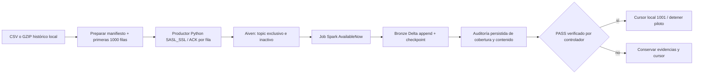

# Twitch: piloto incremental Kafka → Databricks Bronze

> Respaldo Spark conservado. La evaluación nativa solicitada después está en
> [Lakeflow Kafka Beta](kafka_native_evaluation.md); esa guía es la decisión vigente.
> No desplegar ambas rutas simultáneamente.

Estado: implementación del piloto de **1.000 filas**. No constituye evidencia de ingesta
remota. No se habilita escala a 100.000/1 M/10 M/30 M/50 M en esta entrega.

## Auditoría y decisión

Rama `codex/kafka-databricks-bronze-pilot`, basada en
`experimental/full-dataset-124m` (`d3a5358`), independiente de la candidata de sustentación.
La base contiene I4 e I3, preparación de fragmentos con SHA256/ordinales, experimento
1 M y Bronze por bloques de 1 M para 10 M. Preparar fragmentos no demuestra haberlos
procesado en Databricks. No se modifica ninguno de esos módulos.

Se reutilizan `live_monitor.common.source_digest`, `twitch_lakehouse.transforms.classify`
y la clave Silver existente, así como `storage.write_new`: CREATE estricto + append,
sin el problema anterior de `errorifexists`. El productor I4 usa event_id con run_id;
el nuevo productor usa SHA256(source_sha256 + `|` + ordinal), estable entre replays.
El consumidor SQLite I4 y React local siguen siendo un laboratorio independiente.

La decisión confirmada por el usuario es Spark directo → Delta. El caso NBA es una
referencia aportada por el usuario, no una evidencia de capacidad de este workspace.

| Ruta | Condiciones reales | Decisión |
|---|---|---|
| Spark Structured Streaming + Jobs AvailableNow | Fuente Kafka incorporada, autenticación SASL autorizada, egress, secretos, CREATE en esquema nuevo, volumen y permisos Jobs API | Implementada para el piloto; disponibilidad remota pendiente de comprobar |
| Lakeflow Connect Kafka administrado | Beta habilitada por administrador; UC connection con USE CONNECTION; permisos de pipeline/serverless y egress | Alternativa documentada, no desplegada inicialmente |

La documentación de Serverless exige UC para fuentes externas y restringe Maven;
no se asume que las opciones SASL directas estén permitidas en Free Edition.
El piloto debe comprobarlo en el workspace. Una denegación es un bloqueo explícito;
no instalar JARs, abrir Kafka local a internet ni crear cómputo de pago para sortearla.
Lakeflow Kafka visible en Preview tampoco prueba permisos efectivos. Sus pipelines
administrados usan conexión UC y `channel: PREVIEW`; no es el mismo contrato que el
lector Spark SASL implementado aquí. No inventar una opción `databricks.connection`
para sustituirlo sin soporte documentado.

## Arquitectura y contratos



El controlador nunca actúa como consumidor Kafka. La validación usa el resultado del
task Spark y tablas Delta, no el conteo de ACK como sustituto de persistencia.
Un solo controlador y un Job con `max_concurrent_runs=1`; no ejecutar otro escritor.

JSON por mensaje: `twitch_load_id` UUID, `twitch_source_row` ordinal BIGINT desde 1,
`source_sha256`, `event_id`, `historical_replay=true`, `produced_at` UTC técnico,
`raw_line` original. Esquema Spark explícito, sin inferencia. `produced_at` y
`kafka_timestamp` son tiempos técnicos de reproducción, no fechas del histórico.

Manifiesto: versión, archivo, SHA256 de los bytes fuente (GZIP comprimido si aplica),
rango, cantidad, SHA256 de la lista JSON canónica de líneas y topic/identidad de broker.
La identidad del broker debe ser un nombre estable y exclusivo del servicio Aiven;
si se recrea el servicio/topic, cambiar identidad y revisar un nuevo checkpoint.
No reutilizar el checkpoint del piloto para otra fuente, topic ni load_id.

| Identidad / métrica | Propósito |
|---|---|
| source_sha256 + twitch_source_row | Fila fuente, independiente de reenvíos; no es la clave de negocio |
| event_id | Hash de esa identidad fuente; no contiene load_id |
| twitch_load_id | Bloque y sus reintentos; no cambia al reanudar |
| source_cluster_id + topic + partition + offset | Mensaje físico de transporte; `transport_id` es su hash |
| transport_rows | Mensajes físicos de ese load persistidos en Bronze |
| source_rows | Filas fuente distintas confirmadas |
| source_replays | transport_rows − source_rows, incluyendo reenvíos en offsets nuevos |
| transport_duplicates | Repetición del mismo transport_id en Delta: debe ser 0 |
| rejected_source_rows | Filas fuente distintas que incumplen reglas Silver relevantes |
| business_duplicates | Filas válidas fuente − claves de negocio distintas normalizadas |

Clave de negocio: `(user_id, stream_id, streamer_username, time_start, time_stop)`.
Una conexión al chat observada no demuestra un espectador activo. No hay fechas
absolutas históricas, geografía, seguidores ni ingresos inferidos.

## Archivos y destinos

* `kafka_ingest/contracts.py`: límites/contratos e identidad.
* `producer.py`: CSV/GZIP por bloque acotado, manifiesto y ACK fsync por fila.
* `controller.py`: Jobs API, token idempotente, verificación y cursor después del PASS.
* `bronze.py`: proyección Spark, Delta append, bootstrap protegido y auditoría.
* `notebooks/21_kafka_bronze_pilot.py`: entrada Databricks con secretos.
* `deploy/kafka_bronze_pilot.job.json`: plantilla de Job sin calendario ni recursos creados.
* `tests/test_kafka_ingest*.py`: fallos, reenvíos, cobertura, Spark y contenido.

Solo se crean `workspace.twitch_kafka_experimental`, volumen `kafka_state`,
tablas `pilot_binding_v1`, `bronze_kafka_pilot_v1`, `attempt_<uuid>` y `audit_<uuid>`.
Checkpoint fijo `/Volumes/workspace/twitch_kafka_experimental/kafka_state/pilot_v1`.
El binding debe coincidir exactamente con el manifiesto. Bootstrap parcial se detiene.
Bronze con datos y checkpoint ausente se detiene. No se borra ni reemplaza nada.

## Preparación local y Aiven (manual)

No se crea Aiven ni otro recurso externo. Usar un servicio ya autorizado y comprobar
coste/cuota antes de iniciarlo. Configurar manualmente:

1. Topic nuevo `twitch.pilot.<nombre>`, una partición, sin compactación ni otros
   productores; retención suficiente para todo el ensayo y recuperación.
2. Usuario SASL con permisos mínimos de WRITE para publicar y READ/DESCRIBE para Spark.
   Confirmar listener SASL_SSL, mecanismo real y cadena CA. No asumir que mTLS sirve
   para este contrato SASL. Permitir únicamente la conectividad necesaria.
3. Resolver y alcanzar todos los advertised brokers desde Databricks, no solo bootstrap.
   Free Edition limita salida de red; comprobarlo, no desactivar TLS ni hostname checks.
4. Variables locales inyectadas mediante gestor seguro o sesión, nunca valores literales
   en scripts versionados, historial compartido ni `.env` subidos al repo:

| Variable local | Valor / uso |
|---|---|
| KAFKA_BOOTSTRAP_SERVERS | host:puerto SASL_SSL |
| KAFKA_USERNAME / KAFKA_PASSWORD | Usuario y contraseña de productor |
| KAFKA_SASL_MECHANISM | SCRAM-SHA-512 predeterminado; ajustar al servicio |
| KAFKA_SSL_CA_FILE | Ruta local CA PEM, opcional si CA pública confiable |
| DATABRICKS_HOST | URL HTTPS raíz `https://<workspace>.cloud.databricks.com` |
| DATABRICKS_TOKEN | Token local autorizado para Jobs; no se envía al frontend |
| DATABRICKS_BRONZE_JOB_ID | ID del Job configurado abajo |

Este primer cliente usa token de workspace en memoria; si Free no permite emitirlo,
el controlador API está bloqueado. La ejecución manual del notebook puede diagnosticar
Kafka/Delta, pero no valida el controlador extremo a extremo. No pegar tokens al chat.

```powershell
python -m venv .venv-kafka
.\.venv-kafka\Scripts\python -m pip install -r kafka_ingest/requirements.txt
.\.venv-kafka\Scripts\python -m unittest tests.test_kafka_ingest -v
.\.venv-kafka\Scripts\python -m kafka_ingest.controller prepare --source C:\ruta\full_a.csv.gz --block-dir work\pilot-1000 --topic twitch.pilot.twitch1000 --cluster-name nombre-estable-servicio-aiven
```

También acepta el `100k_a.csv` real ya disponible, sin descargar el histórico. No
confundir SHA256 de ese CSV con SHA256 de `full_a.csv.gz`: son poblaciones diferentes.
`prepare` lee solo 1.000 líneas pero calcula SHA256 del archivo completo por streaming,
sin cargarlo en memoria. El piloto no reutiliza fragmentos alterando ordinales.
El módulo de fragmentación experimental será reutilizable para escala; requiere
mantener SHA fuente original + ordinal global, no SHA de cada fragmento como fuente.

## Databricks y primer ensayo remoto

1. Importar la rama en un **Git folder separado**. Reiniciar Python después de Pull
   (`dbutils.library.restartPython()` en una celda independiente), antes de importar
   módulos. No instalar PySpark ni Maven en Serverless.
2. Comprobar manualmente `current_user()`, `SHOW GRANTS ON CATALOG workspace`, permiso
   CREATE SCHEMA y CREATE VOLUME/TABLE en el esquema experimental. Confirmar que no
   existe un destino del piloto con datos de otro intento antes de ejecutar.
3. Crear scope autorizado `twitch-kafka` y keys `bootstrap-servers`, `username`,
   `password`. Para CA privada, añadir key `ca-pem` con certificado CA público PEM,
   nunca claves privadas; configurar `ca_secret_key=ca-pem`. Si crear/leer scope está
   denegado, documentarlo sin introducir contraseñas como parámetros del Job.
4. Editar una copia local de la plantilla Job: rutas absolutas de Git folder y notebook,
   scope, mecanismo y CA. Crear un Job Serverless manualmente o con CLI autenticada:
   `databricks jobs create --json @deploy/kafka_bronze_pilot.job.json`.
   No ejecutar la plantilla con `REPLACE`. No calendario, sin clúster de pago,
   una ejecución concurrente, timeout 30 min, reintentos automáticos deshabilitados.
5. Asegurar que el topic contiene solo este piloto; detener productores antes del Job.
   `maxOffsetsPerTrigger=250` limita un micro-lote, **no el total de AvailableNow**.
   El preflight rechaza topics con más de 5.000 mensajes para acotar reenvíos del piloto.
   No usar un topic con histórico masivo. No publicar concurrentemente durante la lectura.
6. Con variables ya inyectadas, ejecutar:

```powershell
.\.venv-kafka\Scripts\python -m kafka_ingest.controller run --block-dir work\pilot-1000 --rate 100
```

El controlador publica 1.000 eventos y espera ACK individuales; después dispara el
Job con token idempotente persistido. El Job consume AvailableNow con
`failOnDataLoss=true`, escribe Delta append con checkpoint y persiste auditoría.
El controlador compara load/fuente/rango/hash, revisa todos los ACK contra offsets
contiguos observados en Bronze, guarda `verified.json` y solamente entonces `cursor.json`.
No hay bucle automático que publique la siguiente población.

## Aceptación y recuperación

Primer envío sin reintentos: 1.000 ACK, 1.000 transport_rows, 1.000 source_rows,
0 source_replays, 0 transport_duplicates, 0 identity_errors, 0 payload_conflicts,
0 foreign_rows; rango fuente exactamente 1..1000 y hash de líneas igual al manifiesto.
Rechazados y duplicados de negocio se reportan: no se presupone que sean cero.
La conciliación `valid_source_rows + rejected_source_rows = source_rows` debe cumplirse.

Reiniciar el consumidor mediante otro run del **mismo** Job, manifiesto y checkpoint:
Bronze debe conservar el mismo conteo y hash. Registrar IDs de ambos Jobs y auditorías.
Para ensayo de reenvío, usar cliente de prueba controlado y misma identidad fuente;
offsets nuevos aumentan transport_rows, pero no source_rows. No borrar ACK, checkpoints
ni archivos de estado para forzar una prueba. Los fixtures locales prueban esta semántica;
un reenvío remoto requiere evidencia propia antes de declararlo validado.

`work/<bloque>/` conserva manifiesto, payload, ACK JSONL, acked.json, attempt token,
Job ID, fallos sanitizados, verified y cursor. Los datos reales están excluidos de Git.
El botón/comando de parada es crear `work/<bloque>/STOP`: detiene nuevas publicaciones
en la siguiente fila. Quitar SOLO esa señal permite reanudar; no afecta al checkpoint.
Cancelar el Job explícitamente en Databricks si está activo; STOP no cancela un Job.

Si falla publicación parcial: ACK conservados, sin cursor; `run` reenvía el bloque con
los mismos IDs. Kafka idempotente reduce duplicados de red de un proceso, pero no
promete exactamente una publicación tras reiniciar el productor. Bronze conserva
reenvíos para auditoría, Silver futuro deduplica fuente antes de clave de negocio.
Si se pierde respuesta de Jobs, reanudar con el mismo token/run sin republicar ACK completos.
Si el Job falla, usar Repair run manual tras corregir la causa, conservando checkpoint,
y reanudar el controlador. Si el run ya no es reparable, no editar el estado a ciegas:
diagnosticar y añadir una nueva tentativa revisada que conserve todas las evidencias.
Un lock tras caída brusca se libera solo tras verificar que no existe otro controlador
o Job activo. Un archivo parcialmente escrito provoca parada segura, no recreación.

Consultar evidencias (sustituir UUID de auditoría):

```sql
SELECT count(*) AS transport_rows, count(DISTINCT transport_id) AS transport_ids,
       count(DISTINCT source_sha256, twitch_source_row) AS source_rows
FROM workspace.twitch_kafka_experimental.bronze_kafka_pilot_v1;
SELECT topic, partition, min(offset), max(offset), count(*), count(DISTINCT offset)
FROM workspace.twitch_kafka_experimental.bronze_kafka_pilot_v1
GROUP BY topic, partition;
SELECT report_json FROM workspace.twitch_kafka_experimental.audit_UUID;
```

Conservar además capturas del run, tasks, Delta y reporte; tiempos de ACK en acked.json
y tiempos de ejecución Jobs. Nunca guardar opciones Kafka, JAAS ni cuerpos de errores
en capturas. La evidencia local no sustituye esa validación remota.

## Puertas posteriores (sin ejecutar todavía)

| Etapa | Condición previa | Trabajo posterior |
|---|---|---|
| 1.000 | Credenciales/red/cuota y permisos reales | Piloto + reinicio PASS |
| 100.000 | Revisión del PASS anterior | Generalizar contratos/bloques y cobertura distribuida |
| 1 M | PASS 100.000 + recursos medidos | Reutilizar manifiestos/fragmentación, backpressure |
| 10 M | PASS 1 M + retención suficiente | Auditoría global, costes y tiempos por bloque |
| 30 M / 50 M | PASS previo + cuotas/autorización | Aumentar solo con estimaciones medidas |

Esta entrega recoge hasta 1.001 filas en el driver **solo en auditoría del piloto**.
Para escalar, sustituir hash/lista ordenada por comparación distribuida con manifiesto
de rangos/hashes; eliminar ese collect. No sumar distinct parciales ni ejecutar Silver
y Gold por bloque. No afirmar rendimiento de millones a partir de 1.000 eventos.

DAG futuro tras confirmar toda Bronze: Bronze incremental → validación por bloque →
barrera de cobertura global → batch Silver (dedup fuente, rechazos, dedup KEY global) →
Gold global reutilizando transformaciones I1/I3 → auditoría → publicación de snapshot.
Destinos nuevos versionados, sin escribir `workspace.twitch_lakehouse` ni Gold r01.
La clave KEY y los usuarios/streams distintos se evalúan sobre toda Silver confirmada.

FastAPI/React: publicar snapshot Gold inmutable con load/release_id, versión Delta,
conteos conciliados, processed_at técnico y estado `CONFIRMED`. Cambiar el puntero
publicado solo después de auditoría; API de lectura sirve la última versión confirmada
con ETag, React consulta periódicamente y muestra fecha/estado obsoleto ante errores.
No mostrar ACK como Gold ni conectar credenciales del workspace al navegador. Mantener
etiqueta de histórico reproducido y separar explícitamente el laboratorio SQLite.
La integración de esa publicación no se ejecuta antes de aprobar Bronze.

## Fuentes oficiales consultadas

* [Kafka Spark, batch e incremental AvailableNow](https://docs.databricks.com/aws/en/connect/streaming/kafka/).
* [Autenticación SASL y módulos shaded](https://docs.databricks.com/aws/en/connect/streaming/kafka/authentication).
* [Limitaciones Serverless y triggers](https://docs.databricks.com/aws/en/compute/serverless/limitations).
* [Free Edition, egress y cuotas](https://docs.databricks.com/aws/en/getting-started/free-edition-limitations).
* [Lakeflow Kafka Beta: requisitos](https://docs.databricks.com/aws/en/ingestion/lakeflow-connect/kafka-pipeline).
* [Conexión administrada y autenticación](https://docs.databricks.com/aws/en/ingestion/lakeflow-connect/kafka-source-setup).
* [Jobs run-now](https://docs.databricks.com/api/workspace/jobs/runnow) y
  [salida del task](https://docs.databricks.com/api/workspace/jobs/getrunoutput).
