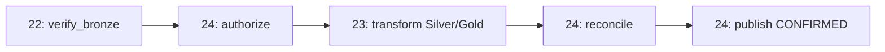

# P0: Job automatizado Bronze Kafka → publicación Delta confirmada

El Job procesa una población Bronze ya persistida. El conector nativo Kafka sigue
siendo independiente y continuo; no se sustituye por otro consumidor ni se agenda
como task de Lakeflow Jobs. No se presenta esta entrega como automatización completa
del productor/Aiven/selección de snapshot ni como integración React.

## DAG reproducible



Todas las dependencias usan ALL_SUCCESS, `max_retries=0`, una ejecución concurrente
y timeout de 20 minutos por task / una hora por Job. Sin calendario, clúster clásico,
instalación de conectores ni servicios externos. La selección Serverless resulta de
omitir cluster settings, conforme al SDK oficial; usar exclusivamente Free Edition.

`kafka_ingest/job_definition.py` genera el JSON Jobs API 2.2. Los tasks reutilizan
notebooks 22 y 23 en modo Job, y sus funciones audit_native, frames, reconcile y
write_new existentes. Notebook 24 controla autorización/conciliación/publicación.
La fuente del Job es **Git remoto fijado por SHA completo**, no el Git folder mutable.
El checkout agrega el root del repo a sys.path; no se importa el código I3 modificado
en otro Git folder ni se descartan cambios locales para ejecutar el Job.

## Parámetros obligatorios y población del primer ensayo

| Parámetro | Ensayo autorizado |
|---|---|
| release_id | kafka_b7_r002: nombre nuevo, distinto de kafka_b7_r001 protegido |
| bronze_version | 7 explícito, nunca latest |
| manifest_table | workspace.twitch_kafka_experimental.native_pilot_binding_v1 |
| manifest_version | 1 explícito; comprobar contra la versión conservada en el manifest previo |
| population | whole_snapshot para este ensayo; load_id para una carga específica posterior |
| code_commit | SHA del código fijado también en git_source |
| job_id / job_run_id | Resueltos por {{job.id}} / {{job.run_id}}, no valores manuales |

El primer ensayo reprocesa la **población de 1.000 filas ya autorizada** en una release
nueva; no afirma nuevos ACK ni una nueva ingesta Kafka. Las tablas kafka_b7_r001
permanecen intactas. Para nuevas versiones usar release `kafka_b<VERSION>_rNNN` y
manifiesto/binding inmutable correspondiente. El contrato del piloto sigue limitado
a 1.000 filas fuente desde ordinal 1; no habilita millones ni rangos nuevos.

En modo `load_id`, solo se auditan/procesan mensajes de esa carga extraídos del JSON
en una versión fija. Se conserva el alcance y el total de filas del snapshot: mensajes
de otras cargas, incluidos no identificables, no se presentan como auditados. No se
suman releases como si fueran nuevos eventos globales ni se mezcla con r01.

## Controles y artefactos

Todos los destinos se fijan en workspace.twitch_kafka_experimental. La verificación
crea `job_bronze_audit_<release>` con PASS/FAIL y snapshot+manifiesto. Fallar la fuente
provoca excepción del task 22 y bloquea todas sus dependencias.

La autorización vuelve a validar PASS, 1.000 identidades, contenido, versión y binding,
y reclama la release con `job_authorization_<release>`. Si ya hay resultados sin esa
reclamación, falla en lugar de adoptarlos. Cada artefacto incluye job_id, job_run_id,
commit, parámetros y SHA256 de contexto. Cambiar versión/manifiesto/release o run en
Repair hace que el contexto no coincida y se detenga antes de escribir resultados.

Transform crea manifest/source_classification/rejects/silver/gold nuevos con las reglas
validadas del notebook 23. No ejecuta su antiguo camino monolítico ni r001.
Conciliación, como task independiente, lee resultados persistidos y recalcula los
14 controles, incluido exceptAll exacto, desde la población autorizada. Registra
versiones Delta de sus cuatro tablas de datos y PASS/FAIL en reconciliation_<release>.

Publish exige PASS y los 14 checks true, verifica que las versiones de las tablas no
cambiaron y crea `job_publication_<release>` con `publication_state=CONFIRMED`, Gold
fijada por versión y conciliación completa. Es un registro confirmado en Delta,
**no** un archivo React, un webhook ni un puntero global que reemplace r01.

## Instalación y ejecución

Preparación local (sin secretos):

```powershell
$jobCommit = git rev-parse HEAD
python -m kafka_ingest.job_definition --commit $jobCommit --output work\kafka-medallion-job.json
databricks jobs create --json @work/kafka-medallion-job.json
```

La creación del Job es un paso explícito, no parte de tests o CI. Se requiere acceso
GitHub ya configurado para el repositorio y permisos Jobs/UC. Alternativa: notebook 25
usa WorkspaceClient con autenticación del notebook, muestra settings para revisión y
crea el Job en una segunda celda; no crea tokens ni dispara carga automáticamente.
No crear otra copia del Job al reintentar una ejecución; conservar su job_id.

Ejemplo run-now, mediante SDK autenticado con OAuth/perfil local o autenticación
nativa de notebook, sin imprimir credenciales:

```python
from databricks.sdk import WorkspaceClient
w = WorkspaceClient()
run = w.jobs.run_now(
    job_id=JOB_ID,
    idempotency_token=TOKEN_ESTABLE_PERSISTIDO_PARA_ESTA_SOLICITUD,
    job_parameters={
        "release_id": "kafka_b7_r002", "bronze_version": "7",
        "manifest_table": "workspace.twitch_kafka_experimental.native_pilot_binding_v1",
        "manifest_version": "1", "population": "whole_snapshot"
    }
)
print({"run_id": run.run_id})
```

No sobrescribir code_commit al lanzar/Repair. Nunca pasar contraseñas Kafka, tokens
ni claves privadas como job parameters. `run-now` aceptado no prueba procesamiento:
esperar SUCCESS de las cinco tareas y consultar job_publication_<release> CONFIRMED.

## Repair controlado

Sin reintentos automáticos. Tras fallo, conservar IDs de run, error y artefactos; en
Jobs UI elegir Repair run con los mismos parámetros y mismo commit. Volver a ejecutar
solo tareas fallidas y dependientes apropiadas. No crear otro run con la misma release.

Una reparación del mismo run puede reutilizar reportes exactamente iguales. Transform
reutiliza tablas solo si su manifest pertenece a esa autorización y cada contenido
coincide por exceptAll con el plan. Un append incompleto o tabla distinta causa fallo,
no relleno automático ni borrado. En ese caso diagnosticar y usar otra release/run
revisada. Nunca limpiar el checkpoint ni hacer Full refresh. El marker AUTHORIZED o
TRANSFORMED no equivale a publicación; únicamente publication CONFIRMED permite uso.

## Coordinación futura productor / API

1. Productor conserva manifiesto y ACK por bloque con ID estable, como ya implementado.
2. Esperar persistencia de Lakeflow; la versión Bronze se fija explícitamente tras
   observar la carga. No usar el mayor offset ACK como prueba de ingesta Delta.
3. Conservar manifest/binding en tabla experimental con versión fija y registrar la
   solicitud local (release, versión, referencia y token idempotente).
4. Enviar run-now con perfil OAuth/token inyectado fuera de Git. Si se pierde respuesta,
   reutilizar token, no republicar ni crear otro run/release a ciegas.
5. Observar get-run y publicación Delta CONFIRMED. Solo entonces avanzar cursor y,
   en otro incremento, exportar snapshot para FastAPI/React.

Este coordinador productor→selección de versión→Job no se afirma implementado E2E.
El cliente anterior del productor `controller run` sigue enlazado al respaldo Spark
Bronze; no utilizarlo como coordinador del Job nativo nuevo sin el adaptador específico.

## Pruebas y aceptación

Tests unitarios: DAG serial ALL_SUCCESS, cero retries, SHA fijo, rechazo de r001,
versiones/manifiestos fuera de alcance, contexto distinto en Repair y FAIL previo
bloqueando autorización/publicación. Test Spark con fixtures artificiales y storage
fake versionado ejecuta las cinco etapas, valida 20 rechazos, repara sin appends y
bloquea publicación si cambia la versión Gold. No equivale a un Job/Delta remoto.

La aceptación remota exige job_id/run_id y cinco tareas SUCCESS, nuevas tablas de
release, 14 checks PASS, publicación CONFIRMED y versiones/carga conciliadas. No se
afirma automatización completa hasta conservar esa evidencia real.

Manuales: instalación inicial/permisos Git/UC, productor y conector Kafka, elección
de snapshot/manifiesto, disparo del Job y decisiones Repair. Automatizados por el Job:
auditoría, autorización, transformación, conciliación y publicación Delta confirmada.

Referencias: [Jobs con Git](https://docs.databricks.com/gcp/en/jobs/git),
[imports desde Git](https://docs.databricks.com/aws/en/files/workspace-modules),
[SDK y Serverless](https://docs.databricks.com/aws/en/dev-tools/sdk-python),
[referencias dinámicas](https://docs.databricks.com/aws/en/jobs/dynamic-value-references),
[parámetros y Repair](https://docs.databricks.com/gcp/en/jobs/job-parameters).
