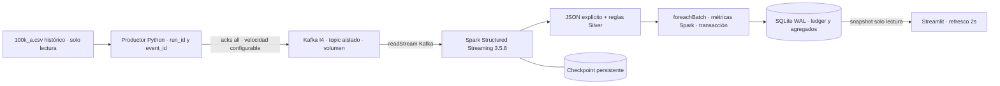

# Arquitectura I4 y contrato de actualización

## Contrato JSON versión I4

`run_id STRING` UUID canónico; `source_sha256 STRING` 64 hex; `source_row BIGINT`
positivo; `event_id STRING` SHA256(run_id|source_sha256|source_row);
`historical_replay BOOLEAN` true; `produced_at STRING` con timestamp convertible;
`raw_line STRING` conserva línea CSV de cinco campos. Spark usa from_json con
StructType/DDL explícito, modo PERMISSIVE y columna corrupta. No se infieren tipos
ni se confía en campos numéricos calculados por productor.

Spark aplica `twitch_lakehouse.transforms.classify` de I1 sin modificarlo:
cinco tokens sin comillas, trim, regex entero, try_cast BIGINT, IDs positivos,
nombre no vacío, pasos 0..2147483647, stop>=start. Se admite duración cero;
minutos=(stop-start)*10. Se añaden comprobaciones de identidad, reproducción y
timestamp técnico. Errores se conservan, nunca se descartan silenciosamente.
Timestamp de producción/procesamiento es real del replay, no fecha histórica.

## Identidad e idempotencia

- **Ejecución:** manifiesto en runs vincula run_id a hash/rango. Otro run_id
  representa otra demostración deliberada. No mezclar sus eventos con Silver I1.
- **Evento:** clave estable aunque Kafka reciba reintentos en nuevos offsets.
  Si falta identidad verificable, clave por topic/partición/offset: inválidos no
  identificables se cuentan por mensaje físico, no se presume igualdad semántica.
- **Transporte:** PK (topic,partition,offset) registra cada mensaje recibido. Los
  offsets de lote son rangos inclusivos; no son timestamps históricos.
- **Micro-lote:** PK (pipeline_id,batch_id) es ledger de commit. pipeline_id
  persiste junto con checkpoint y SQLite, no se genera al reiniciar.
- Spark transforma, valida y agrega solo eventos aún no persistidos; el driver
  ejecuta transacción BEGIN IMMEDIATE: ledger de eventos+offsets+agregados+lote.
  Si el proceso cae después de commit y antes del checkpoint, Spark reintenta y
  el ledger evita aplicar el micro-lote otra vez. Antes de commit todo revierte.
- payload_hash incluye línea y errores de calidad, ignora produced_at válido
  para permitir reenvío. Misma identidad con contenido/calidad diferente detiene
  el sink con rollback, en lugar de elegir arbitrariamente una versión.
- No se deduplica por clave Silver entre distintas filas del CSV: la demo cuenta
  eventos fuente identificados por ordinal. Se mantiene separado de métricas batch
  ya deduplicadas. La primera muestra real debe conciliar sus 100 filas.

## Almacenamiento y concurrencia

SQLite en volumen Linux, WAL, synchronous=FULL, busy_timeout; sin bind de DB a
filesystem Windows. Lock flock de consumidor y productor impide dos procesos
del mismo rol. Transacción corta por micro-lote acotado a 25 offsets; el productor
escribe manifiesto/acks, no métricas. Lectores abren mode=ro y BEGIN para que todos
los widgets reciban un snapshot coherente. SQL usa parámetros para run_id.

Tablas: metadata (pipeline/origen), runs (manifiesto/control productor), events
(ledger válido/inválido), transport (offsets), batches (commit/métricas/rangos),
streamer_metrics (sumas calculadas por Spark), consumer_status (heartbeat).
SQLite suma esos agregados para vistas globales; no inventa observaciones.
El tiempo de evolución es completed_at del sink; no es concurrencia de chat.

## Offsets y recuperación

startingOffsets=earliest solo para nuevo checkpoint; reinicio utiliza checkpoint,
sin commit manual de grupo Kafka. failOnDataLoss=true. Broker persistente I4 y
topic explícito de una partición; no datos de I2. Source binding de cluster/topic
detecta algunos cambios de origen; no sustituye backup conjunto ni garantiza
detectar recreación del topic en el mismo cluster. DB procesada sin metadata del
checkpoint provoca error. Nunca borrar estado como recuperación automática.

## Actualización real del dashboard

`st.fragment(run_every='2s')` consulta SQLite mientras hay sesión abierta. Solo
lee eventos/agregados cuyo micro-lote completó commit. Ningún temporizador aumenta
conteos. Heartbeat se escribe por el consumidor; más de 15s sin señal se muestra
como SIN SEÑAL RECIENTE, sin deducir que esté procesando. Último lote y offsets
son globales; selección run_id afecta métricas/gráficos de esa reproducción.
Si falta DB, muestra espera sin números. Un fallo/fin del consumidor no borra
resultados previos. UI lee reloj únicamente para estado/consulta.

## Límites deliberados

Driver recoge micro-lotes pequeños para sink SQLite: no diseñado para 124M ni
alta disponibilidad. Kafka monobroker sin TLS/autenticación, aislado sin puertos
host. Streamlit loopback; no servicio cloud. Imagen y paquetes fijados por versión
(conservar digest real del build en evidencia). No promete exactly-once universal:
garantía condicionada a claves, transacción y conservación conjunta de estado.

Fuentes oficiales: [Spark/Kafka 3.5.8](https://spark.apache.org/docs/3.5.8/structured-streaming-kafka-integration.html),
[foreachBatch y checkpoint](https://spark.apache.org/docs/3.5.8/structured-streaming-programming-guide.html),
[imagen Spark](https://github.com/apache/spark-docker/blob/master/versions.json),
[Streamlit fragment](https://docs.streamlit.io/develop/api-reference/execution-flow/st.fragment).
